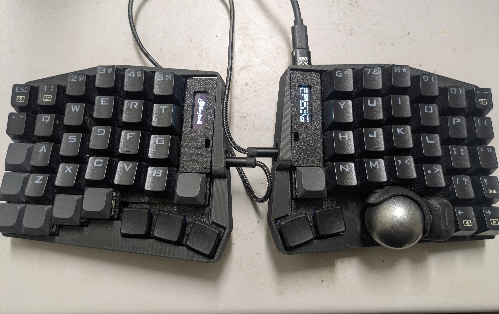

# keyball61

Yowkees/keyball 系 Keyball61 (PMW3360トラックボール搭載、RP2040互換Pro Micro使用中の個体)
Layerは0,1,2しか使いません。

keymapの特徴としては、普通のkeyboardと使い心地を同じにしている点で、矢印操作や一部の入りきらない記号などをfnキーを使って入力する必要があります。それ以外は基本的に使い心地は大きく変わりません。

